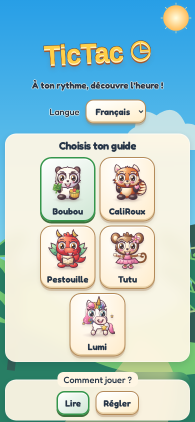
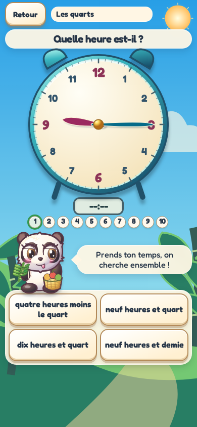
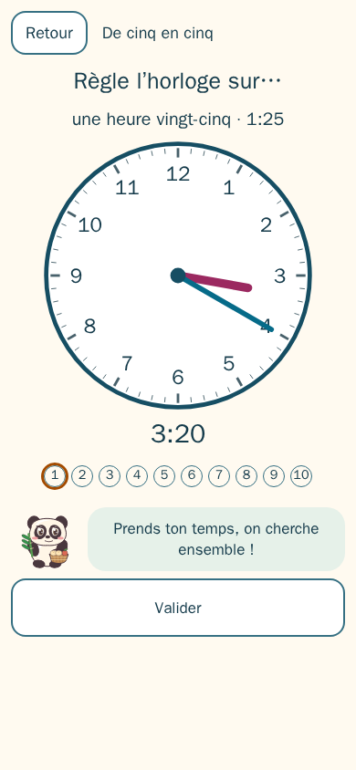
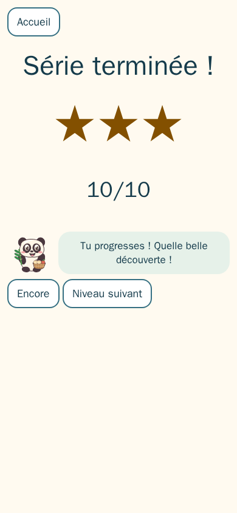

<h2 align="center"><a href="https://davy45270.github.io/tictac/">▶ Jouer / Play</a></h2>
<p align="center">Dans le navigateur, sur téléphone ou ordinateur. Installable, fonctionne hors ligne.</p>

# TicTac

[English](README.md)

Un jeu doux pour apprendre à lire l’heure de 5 à 9 ans. L’enfant déplace les aiguilles au doigt, observe l’affichage numérique et choisit son guide : Boubou, CaliRoux, Pestouille, Tutu ou Lumi. Français par défaut, anglais disponible. Aucun chronomètre, compte ni publicité.

[Jouer en ligne](https://davy45270.github.io/tictac/).

Douze niveaux : heures pleines, demies, quarts, tranches de cinq minutes, minute près, format 24 h, calcul « dans quelques minutes », moments de la journée, réponses en chiffres, cadran sans chiffres, chiffres romains, midi ou minuit. La plupart proposent de lire et de régler. Chaque série compte dix questions ; deux étoiles débloquent les niveaux qui s’appuient dessus. Après une erreur, on peut réessayer tranquillement, et un exercice proche revient plus tard.

Un espace parents (derrière une petite multiplication) indique pour chaque leçon si elle est acquise : deux séries récentes avec au moins 18 réponses sur 20 justes du premier coup, aucune rafale d’essais au hasard et plus rien à revoir. Il reste sur l’appareil.

## Captures d’écran

Interface française sur un téléphone en portrait de 390 × 844 pixels.

| Accueil avec Boubou et étoiles gagnées | Lire les quarts d’heure (niveau 3) |
| --- | --- |
|  |  |
| Régler par tranches de cinq minutes (niveau 4) | Série à trois étoiles |
|  |  |

Après compilation (`npm run build`) et installation de Chromium (`npx playwright install chromium`), régénérer les quatre images avec `npm run screenshots`. Le scénario mobile activé à la demande écrit les PNG de la fenêtre dans `docs/screenshots/` ; ces images de documentation restent hors du build et du précache PWA.

## Installer et développer

Dans le navigateur, choisir Installer ou Ajouter à l’écran d’accueil. Après une première visite complète en ligne, le jeu fonctionne hors connexion.

Utiliser la version Node de `.nvmrc` puis :

```sh
npm ci
npm run dev
npm run lint
npm run typecheck
npm test
npm run build
npx playwright install chromium
npm run test:e2e
```

Les tests unitaires vérifient le moteur pur, les séries, les textes, la sauvegarde et les personnages. Les tests navigateur couvrent le doigt bruité, les progrès, le clavier, les langues et le hors-ligne. Les icônes se régénèrent avec `node scripts/make-icons.js`. Les règles précises figurent dans [GAME_SPEC.md](GAME_SPEC.md).

## Vie privée

Tout progrès reste sur le téléphone, avec le suivi des parents, la langue et le guide choisis. Aucune collecte, aucun traceur, aucune publicité ni requête applicative de données. Seuls les fichiers statiques et le service worker sont téléchargés pour installer le jeu. Le bouton Écouter utilise la synthèse vocale du navigateur ; seules les voix locales de la langue choisie sont utilisées, et le bouton est masqué si aucune n’est disponible.

Licence MIT © 2026 David Sevin — [LICENSE](LICENSE).
