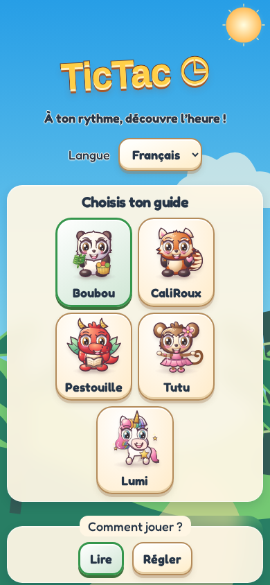
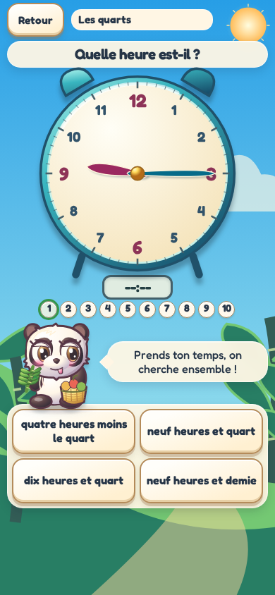
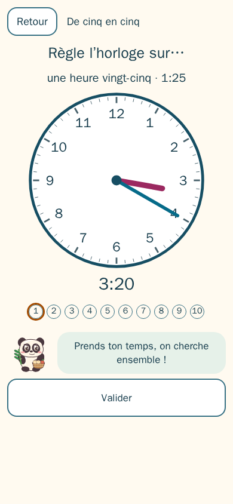
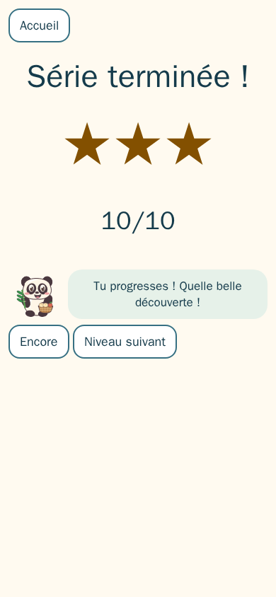

# TicTac

[Français](README.fr.md)

A gentle, French-first clock game for children aged 5–9. Drag real analog clock hands with a finger, read the digital clock and learn with Boubou, CaliRoux, Pestouille, Tutu or Lumi. English is also available. No timer, ads or accounts.

[Play online](https://davy45270.github.io/tictac/).

Eight levels: whole hours, half hours, quarter hours, five-minute steps, exact minutes, 24-hour time, adding minutes, and parts of the day. Levels 1–7 offer reading and setting exercises. Ten questions make a session. Earn two stars to unlock the next level; mistakes invite another try without pressure.

Use your browser’s install / Add to Home Screen action to install the PWA. After the first complete online visit, the game works offline. All artwork is procedural SVG; the app’s only PNG assets are the reproducible PWA icons.

## Screenshots

French interface on a 390 × 844 portrait phone.

| Home with Boubou and earned stars | Reading quarter hours (level 3) |
| --- | --- |
|  |  |
| Setting five-minute steps (level 4) | Three-star session |
|  |  |

After building (`npm run build`) and installing Chromium (`npx playwright install chromium`), regenerate all four images with `npm run screenshots`. The opt-in mobile spec writes viewport PNGs to `docs/screenshots/`; they are documentation assets, excluded from the app build and PWA precache.

## Development

Use the Node version in `.nvmrc`.

```sh
npm ci
npm run dev
npm run lint
npm run typecheck
npm test
npm run build
npx playwright install chromium
npm run test:e2e
```

Unit tests cover the pure engine, generation, language, persistence, characters and brand boundaries. Browser tests cover touch gestures, progression, accessibility, language and offline reloads. Regenerate icons with `node scripts/make-icons.js`. See [GAME_SPEC.md](GAME_SPEC.md) for the exact rules and test oracle.

## Privacy

Progress, language and guide selection stay in `localStorage` on this device. No analytics, advertising, trackers or application data requests. The initial installation downloads the static app and service worker; no personal data is sent by the game. The optional Listen button uses the browser’s speech synthesis. Only local voices matching the interface language are used; the button is hidden when none are available.

MIT © 2026 David Sevin. See [LICENSE](LICENSE).
